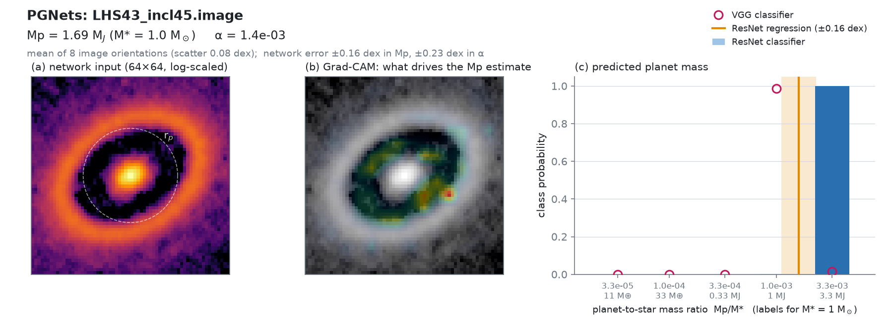

[](https://zenodo.org/badge/latestdoi/346921325)
[](https://arxiv.org/abs/2111.15196)

# PGNets — planet mass from a disc-gap image

**PGNets** (Planet Gap neural Networks) are convolutional neural networks that read a
dust-continuum image of a protoplanetary disc with a gap and estimate **the mass of the
planet that opened the gap** and **the disc viscosity α**.
They are described in
[Zhang, Zhu & Kang 2022, MNRAS 510, 4473](https://ui.adsabs.harvard.edu/abs/2022MNRAS.510.4473Z/abstract)
([arXiv:2111.15196](https://arxiv.org/abs/2111.15196)).

Give it a FITS image and the gap radius; it gives back numbers and a one-page figure:

```bash
pgnets data/LHS43_incl45.image.fits --rp-au 40 --dist-pc 140 --mstar 1
```



*Example output. The input is a simulated ALMA observation of a disc with a 2.28 M<sub>J</sub> planet
and α = 1.4×10⁻³. PGNets recovers 1.7 M<sub>J</sub> and α = 1.4×10⁻³. The mass is 0.13 dex low,
within the network's 0.16 dex error.
(a) the image the network sees; (b) Grad-CAM: the mass estimate is driven by the gap and its edges;
(c) the two classifiers and the regression, on one mass axis.*

---

## What was done

| Step | Details |
|---|---|
| **Training images** | 2-D hydrodynamic planet–disc simulations of [Zhang et al. (2018)](https://doi.org/10.3847/2041-8213/aaf744) (DSHARP), converted to 1.3 mm continuum images with the [Birnstiel et al. (2018)](https://doi.org/10.3847/2041-8213/aaf743) opacities. Grid: 5 planet masses × 3 disc scale heights × 3 viscosities × 32 dust size distributions × 5 inclinations × 24 position angles = **172,800 images** (64×64). |
| **Pre-processing** | Centre on the star, crop to ±2.1 r<sub>p</sub>, resample to 64×64, scale as (log₁₀ I − log₁₀ I<sub>max</sub> + 2)/2 and clip to [0, 1]. Training images also get random noise at 10% of the image's standard deviation. Split 60/20/20 into train/validation/test. |
| **Classification** | A VGG-like CNN and a ResNet-v2 (depth 20) sort an image into one of 5 mass classes, M<sub>p</sub>/M<sub>*</sub> = 3.3×10⁻⁵, 10⁻⁴, 3.3×10⁻⁴, 10⁻³, 3.3×10⁻³. **Test accuracy: 92% (ResNet).** |
| **Regression** | A ResNet trained on extra simulations whose (M<sub>p</sub>, α, h/r) come from Latin-hypercube sampling predicts M<sub>p</sub> and α as continuous values. **1σ error: 0.16 dex in M<sub>p</sub>, 0.23 dex in α.** It recovers the α ∝ M<sub>p</sub>³ degeneracy known from gap-width fitting. |
| **Interpretability** | Grad-CAM shows the networks rely on the gap and the ring edges. |
| **Application** | DSHARP discs AS 209, Elias 24, GW Lup and Sz 114 (see [below](#reproducing-the-paper)). |

**Range of validity** (the training range; outside it the networks extrapolate):
M<sub>p</sub>/M<sub>*</sub> = 3×10⁻⁵ – 3×10⁻³, α = 10⁻⁴ – 10⁻², h/r = 0.05 – 0.10 at the planet, and one
dominant gap carved by one planet.

---

## Installation

The trained weights are stored with [Git LFS](https://git-lfs.com).

```bash
git lfs install            # once per machine (brew install git-lfs / conda install git-lfs)
git clone https://github.com/zhangsj96/PGNets.git
cd PGNets
pip install -e .           # Python 3.9–3.11; installs TensorFlow 2.x (<2.16) and the `pgnets` command
```

No Git LFS? Clone normally, then run `pgnets --download-models` to fetch the weights.

> The saved models are in Keras-2 format, so TensorFlow ≥ 2.16 (Keras 3) cannot load them.
> `pip install -e .` pins a compatible version. `tensorflow==2.15` works on Apple Silicon.

## Use it on your own image

```bash
# gap radius in arcsec
pgnets my_disc.fits --rp-arcsec 0.48 --mstar 0.8

# or in au + distance
pgnets my_disc.fits --rp-au 61 --dist-pc 158 --mstar 0.8 -o my_disc_pgnets.png
```

Output (for the example at the top):

```
Regression (ResNet): Mp/M* = 1.61e-03  ->  Mp = 1.69 M_J (536 M⊕) (M* = 1.0 M_sun)
                     alpha = 1.4e-03
                     scatter over 8 image orientations: 0.08 dex (Mp), 0.07 dex (alpha)
                     network test-set error: 0.16 dex (Mp), 0.23 dex (alpha)
Classifier (ResNet):   3.3 MJ-class (Mp/M* = 3.3e-03), p = 1.00
Classifier (VGG):        1 MJ-class (Mp/M* = 1.0e-03), p = 0.99
```

| Option | Meaning |
|---|---|
| `--rp-arcsec` / `--rp-au` + `--dist-pc` | Radius of the gap (where the planet is). **Required for FITS input.** It sets the ±2.1 r<sub>p</sub> crop. |
| `--center` | Position of the star: `peak` (brightest pixel, default), `image` (image centre), or `x,y` in pixels. |
| `--mstar` | Stellar mass in M<sub>☉</sub>. Without it, masses are reported as M<sub>p</sub>/M<sub>*</sub>. |
| `--single-orientation` | By default the image is evaluated in all 8 rotations/reflections and the results are averaged, because the networks are not exactly rotation-invariant. The spread is reported and is usually < 0.1 dex. This flag uses the image as given, as in the paper. |
| `--save-input x.npy` | Save the 64×64 network input so you can inspect it. |
| `--no-plot` | Numbers only. |

You can also pass a 64×64 `.npy` file that is already pre-processed instead of a FITS file.

**From Python**

```python
import pgnets
x = pgnets.load_input("my_disc.fits", rp_arcsec=0.48)   # -> 64x64 array
pred = pgnets.predict(x, mstar=0.8)
print(pred.summary())
pred.q, pred.alpha, pred.resnet_probs                    # raw numbers
```

**Things to check**

* In panel (a), the gap should sit on the dashed r<sub>p</sub> circle with the star in the centre.
  If not, fix `--rp-*` or `--center`.
* The image is log-scaled over 2 decades below the peak, so emission fainter than 1% of the peak is ignored.
* The networks were trained on simulated images. A noisy, poorly resolved, or multi-gap disc may be outside
  the training set. If the two classifiers and the regression disagree strongly, be cautious.

---

## Reproducing the paper

The numbers below can be reproduced from this repository without the large training set:

```bash
for d in AS_209 Elias_24 GW_Lup Sz_114; do pgnets data/$d.npy --single-orientation --no-plot; done
pgnets data/LHS43_45incl_ALMA.npy --single-orientation --no-plot --mstar 1
```

| Disc | VGG class | ResNet class | ResNet regression M<sub>p</sub>/M<sub>*</sub> |
|---|---|---|---|
| AS 209   | 1.0×10⁻⁴ (33 M⊕) | 3.3×10⁻⁴ (0.33 M<sub>J</sub>) | 5.2×10⁻⁴ |
| Elias 24 | 1.0×10⁻⁴ (33 M⊕) | 1.0×10⁻⁴ (33 M⊕) | 2.1×10⁻⁴ |
| GW Lup   | 3.3×10⁻⁵ (11 M⊕) | 3.3×10⁻⁵ (11 M⊕) | 4.9×10⁻⁵ |
| Sz 114   | 3.3×10⁻⁵ (11 M⊕) | 3.3×10⁻⁵ (11 M⊕) | 1.1×10⁻⁴ |
| Simulated ALMA obs. (truth 2.2×10⁻³, α = 1.4×10⁻³) | 1.0×10⁻³ | 3.3×10⁻³ | 1.8×10⁻³ (α = 1.3×10⁻³) |

(Mass labels in M⊕/M<sub>J</sub> assume a 1 M<sub>☉</sub> star.) Figures for each disc are in [`examples/`](examples/).

| Paper result | Where |
|---|---|
| Predictions for the DSHARP discs | [`notebooks/predict_planet_mass.ipynb`](notebooks/predict_planet_mass.ipynb), or the commands above |
| Training curves | [`notebooks/plot_accuracy.ipynb`](notebooks/plot_accuracy.ipynb) (uses `data/*_history.txt`) |
| Regression + Grad-CAM on a simulated ALMA observation | [`notebooks/GradCAM_Simobserve.ipynb`](notebooks/GradCAM_Simobserve.ipynb) ‡ |
| Confusion matrices | [`notebooks/plot_confusion_matrices.ipynb`](notebooks/plot_confusion_matrices.ipynb) † |
| Grad-CAM for the classifier | [`notebooks/make_GradCAM.ipynb`](notebooks/make_GradCAM.ipynb) † |
| Training the VGG / ResNet classifiers | [`notebooks/VGG_training.ipynb`](notebooks/VGG_training.ipynb), [`notebooks/resnet_training.ipynb`](notebooks/resnet_training.ipynb) † |

† Needs the 2.8 GB training set `simimgs.npy` (shape `(5, 3, 3, 1, 32, 5, 24, 64, 64)` =
M<sub>p</sub> × h/r × α × dust slope × a<sub>max</sub> × inclination × PA × image):

```bash
curl -L -o data/simimgs.npy https://www.physics.unlv.edu/~shjzhang/simimgs.npy
```

‡ The ALMA-observation part runs from this repository. The noise-free comparison image needs the
Latin-hypercube simulation cube `LHS_incl3.npy`, which is not included.

Training the ResNet takes about 2 hours on a GPU and about 2.5 days on a laptop CPU.
`notebooks/plot_models.ipynb` is a scratch notebook from development and refers to files that are not in the repository.

## Repository layout

```
pgnets/        Python package and `pgnets` command (pre-processing, models, Grad-CAM, figure)
models/        trained networks: resnet/ and VGG_like/ (classifiers, Git LFS), resnet_regression (HDF5)
data/          pre-processed 64×64 images of four DSHARP discs, a simulated ALMA observation
               (FITS + .npy), the Latin-hypercube parameters, and training histories
notebooks/     the notebooks used for the paper
examples/      output figures from the commands above
```

## Citation

If you use PGNets, please cite
[Zhang, Zhu & Kang (2022), MNRAS 510, 4473](https://ui.adsabs.harvard.edu/abs/2022MNRAS.510.4473Z/abstract)
(BibTeX from that ADS page), and the simulation and opacity papers it builds on:
[Zhang et al. (2018)](https://doi.org/10.3847/2041-8213/aaf744) and
[Birnstiel et al. (2018)](https://doi.org/10.3847/2041-8213/aaf743).
